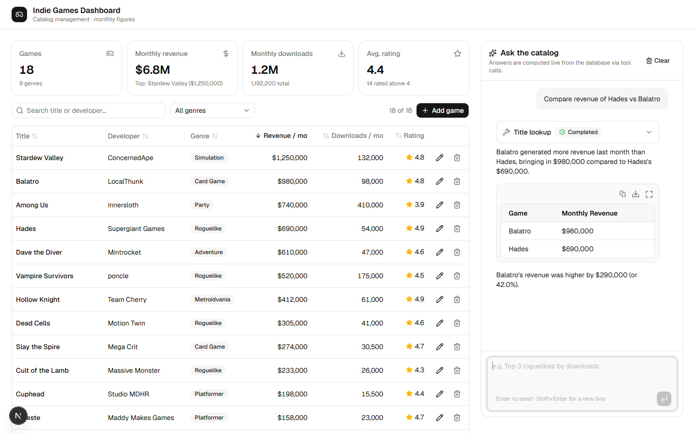
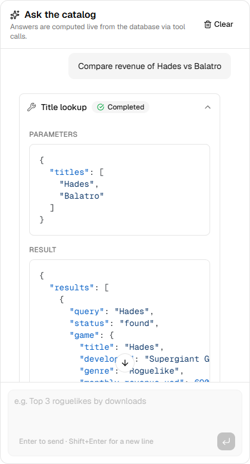

# Indie Games Dashboard

An internal dashboard for managing a catalog of indie games, with an **AI assistant that answers
questions about the catalog by calling tools against the database** and streaming its answers.

Built for the [Full Stack Engineer (AI) assessment](https://github.com/Red-Valley/tech-test-fullstack-engineer-ai).
How AI coding tools were used is documented in [`AI_WORKFLOW.md`](AI_WORKFLOW.md).



## Features

- **Games CRUD.** Sortable and searchable table, genre filter, stats cards, a create/edit dialog
  with field-level validation, and delete confirmation.
- **REST API.** `GET/POST /api/games` and `GET/PATCH/DELETE /api/games/:id`, validated with Zod.
- **AI chat with tool calling.** Google Gemini answers through three tools that query SQLite. The
  model never sees the full database; it gets only the rows and aggregates the tools return.
- **Streaming.** Tokens and tool-call states stream into the UI. Each tool call is shown as an
  expandable card with its parameters and result, so you can check where every number came from.
- **Responsive and accessible.** Two-column layout on desktop, stacked on mobile. Keyboard-usable
  dialogs, `aria-sort` on sortable headers, and system dark mode.

## Quick start

Requires **Node.js 22.12+** (an `.nvmrc` is included; `nvm use` picks it up).

```bash
npm install
cp .env.example .env.local   # then paste your Gemini API key into .env.local
npm run dev                  # http://localhost:3000
```

1. Get a free Gemini API key at **https://aistudio.google.com/apikey** (no credit card needed).
2. Set `GOOGLE_GENERATIVE_AI_API_KEY=` in `.env.local`.
3. The SQLite database is created and seeded with 18 games on first start, in `data/games.db`.

Try these in the chat:

- "Which game made the most revenue last month?"
- "How many games are rated above 4?"
- "Compare revenue of Hades vs Balatro"
- "Which genre earns the most in total?" / "Top 3 roguelikes by downloads" / "compare cuphed and celest"

| Script | What it does |
|---|---|
| `npm run dev` | Dev server with hot reload |
| `npm run build` / `npm start` | Production build and server |
| `npm test` | Unit tests (Vitest, in-memory SQLite, no API key needed) |
| `npm run typecheck` | Generates Next route types, then `tsc --noEmit` |
| `npm run lint` | ESLint (Next.js core-web-vitals + TypeScript) |
| `npm run db:reset` | Deletes the local DB; it is re-seeded on next start (stop the server first) |

### Environment variables

| Variable | Required | Default | Notes |
|---|---|---|---|
| `GOOGLE_GENERATIVE_AI_API_KEY` | yes (for chat) | – | The dashboard and API work without it; the chat shows a clear error |
| `GEMINI_MODEL` | no | `gemini-3.5-flash-lite` | See [Model choice](#model-choice) |
| `DATABASE_PATH` | no | `./data/games.db` | SQLite file location |

## Stack

**Next.js 16** (App Router, Cache Components) · **React 19** · **TypeScript** (strict) ·
**Tailwind CSS v4** · **shadcn/ui** (dashboard) · **AI Elements** (chat components) ·
**Vercel AI SDK v7** + `@ai-sdk/google` · **SQLite** via `better-sqlite3` · **Zod 4** · **Vitest**

## Architecture

```
Browser
 ├─ Dashboard (client)  ──fetch──▶  /api/games, /api/games/:id  ─┐
 │                                                               │
 └─ Chat (useChat)  ──POST, SSE stream──▶  /api/chat             │
                                            │  streamText(...)   │
                                            ▼                    │
                                      Gemini ⇄ tools ────────────┤
                                     (searchGames,               ▼
                                      getCatalogStats,   repository.ts  ──▶  SQLite
                                      getGamesByTitle)   (only module that runs SQL)
```

- **One data path.** The REST routes, the server-rendered page and the AI tools all go through
  `src/lib/games/repository.ts`, so the API, the table and the chat can't disagree.
- **One validation source.** `src/lib/games/schema.ts` (Zod) validates HTTP bodies and query
  params on the server, and the same schema gives the form instant client-side errors.
- **Rendering.** The page shell and chat are prerendered. The catalog is read at request time
  inside `<Suspense>` (with `connection()`), and the build reports `/` as *Partial Prerender*.

```
src/
├─ app/
│  ├─ page.tsx                  # layout: catalog (server, streamed) + chat panel
│  └─ api/
│     ├─ games/route.ts         # GET (filter/sort/paginate), POST
│     ├─ games/[id]/route.ts    # GET, PATCH, DELETE
│     └─ chat/route.ts          # streaming chat with tools
├─ components/
│  ├─ dashboard/                # stats cards, table, form + delete dialogs
│  ├─ chat/chat-panel.tsx       # useChat + AI Elements
│  ├─ ai-elements/              # vendored AI Elements, trimmed to what the chat uses
│  └─ ui/                       # vendored shadcn/ui primitives
└─ lib/
   ├─ games/                    # schema, repository, database init, seed, API client
   ├─ ai/                       # model config, system prompt, tool definitions
   ├─ db.ts                     # SQLite connection (server-only)
   └─ fuzzy.ts                  # "did you mean" title matching
```

## REST API

All responses are JSON. Successful responses use `{ "data": ... }`. Errors use
`{ "error": { "message", "fieldErrors"? } }` with status `400` (validation), `404` or `409`
(duplicate title).

| Method | Path | Description |
|---|---|---|
| `GET` | `/api/games` | List games. Query: `search`, `genre`, `developer`, `min_rating`, `max_rating`, `min_revenue`, `max_revenue`, `min_downloads`, `max_downloads`, `sort` (any field), `order` (`asc`/`desc`), `limit`, `offset`. Returns `{ data, total }`. |
| `POST` | `/api/games` | Create a game (all fields required). Returns `201`. |
| `GET` | `/api/games/:id` | Get one game. |
| `PATCH` | `/api/games/:id` | Partial update. |
| `DELETE` | `/api/games/:id` | Delete. Returns `204`. |

```bash
curl "localhost:3000/api/games?min_rating=4.5&sort=monthly_revenue_usd&order=desc&limit=3"

curl -X POST localhost:3000/api/games -H "content-type: application/json" -d '{
  "title": "Tunic", "developer": "Andrew Shouldice", "genre": "Adventure",
  "monthly_revenue_usd": 88000, "monthly_downloads": 9100, "average_rating": 4.6 }'
```

Fields: `title` (unique, case-insensitive), `developer`, `genre`, `monthly_revenue_usd` (≥ 0),
`monthly_downloads` (integer ≥ 0) and `average_rating` (0–5).

## How the AI chat works

`POST /api/chat` validates the incoming UI messages against the tool schemas. It then calls
`streamText` with the system prompt and three tools, allowing up to 5 steps (tool call → result →
answer), and streams the result back over SSE.

| Tool | Use | Returns |
|---|---|---|
| `searchGames` | Rankings and filtered lists ("top 3 roguelikes by downloads") | `total_matching` plus up to 25 compact rows |
| `getCatalogStats` | Counts, totals, averages; optional `groupBy` genre/developer | Overall stats plus top 25 groups and `total_groups` |
| `getGamesByTitle` | Details and comparisons ("Hades vs Balatro") | Per title: `found` / `ambiguous` (with candidates) / `not_found` (with `didYouMean`), plus a precomputed `comparison` (leaders per metric, ties, absolute and % differences) when 2+ games are found |

Design decisions:

- **No catalog data in the prompt.** The system prompt describes the schema and how to answer.
  Data only arrives through tool results, which are capped and stripped to the fields the model
  needs.
- **Unambiguous filters.** Numeric filters use `{ gt, gte, lt, lte }`. When an early test was given
  a plain `minRating`, a model encoded "rated above 4" as `minRating: 4.0001`. With explicit bounds,
  "above 4" becomes `{ gt: 4 }` (the seed includes a game rated exactly 4.0 to check this).
- **No arithmetic or overreach by the model.** Differences and percentages come from the tool's
  `comparison` block, so they're computed in code: in testing, a model left to compute them gave
  310.6% where the right answer was 318.4%. The prompt also requires every claim to be backed by
  tool results, so the model doesn't call something "the highest in the catalog" after looking
  at three games. For superlatives it fetches the top few rows, so ties are reported (Hades and
  Hollow Knight both at 4.9).
- **Self-correcting tools.** Unknown genres return the list of known genres. Unmatched titles
  return fuzzy `didYouMean` suggestions, so "compare cuphed and celest" comes back with *"Assuming
  you meant Cuphead…"*.
- **Errors.** Tools return `{ error }` instead of throwing, so the stream never breaks. Provider
  errors (429 rate limit, 503 overload, bad key) become readable messages, and the UI offers
  **Retry**. **Stop** and **Clear** abort the request on the server too.
- **"Last month".** The data model has one set of monthly figures per game, so "last month"
  means those fields. The assistant says so if asked about trends.



### Model choice

The default is `gemini-3.5-flash-lite` with `thinkingLevel: "low"`:

- Free Gemini quotas are **per model**, and each tool step is a separate request. With
  `gemini-3.8-flash` the free tier allowed only **5 requests/min and 20/day**, which is about 7
  questions a day.
- Flash-Lite answered every test question correctly and returned the first token in about 2–3 s
  instead of 3–13 s.
- `gemini-2.5-flash` returns 404 for new API keys.

You can override the model with `GEMINI_MODEL`.

## Testing

- **Unit tests (20).** `npm test` runs against in-memory SQLite and covers repository CRUD,
  filters (including inclusive vs. exclusive bounds and escaped LIKE wildcards), grouping,
  seeding, genre canonicalisation, every tool handler (found / ambiguous / not found / genre hints
  / comparison maths and ties) and the fuzzy matcher.
- **Chat question set.** About 15 real questions, run against the live model after every prompt
  or tool change: the brief's three examples, a misspelled title, a game not in the catalog,
  per-genre totals, rankings, a three-game comparison, a tie, a partial genre name and an
  off-topic request.
- **API smoke tests.** Every endpoint and error status was checked with `curl`.
- **Browser end-to-end.** A Playwright script drove the real app: sort, validation, duplicate
  title, create, edit, chat, delete, mobile.
  - This caught a mobile horizontal-overflow bug and a blank select that unit tests couldn't.
  - It also confirmed the chat reads live data: after a game is edited to 4.6, "how many above 4?"
    goes from 14 to 15.
- **Static checks.** `npm run typecheck`, `npm run lint` and `npm run build` are clean.

LLM answers aren't asserted in CI: they're non-deterministic and need a key. The tool logic they
depend on is unit-tested.

## Trade-offs and limitations

- **Vercel AI SDK instead of LangChain/LangGraph.** One model, three tools and streaming into React
  is exactly what the AI SDK covers. LangChain would add a large abstraction layer without adding
  anything here; LangGraph makes sense for multi-agent or stateful workflows.
- **SQLite with `better-sqlite3`.** Real persistence with no setup. Synchronous queries are fine at
  this scale. A shared deployment would need a server database.
- **Client-side table sort and filter.** The UI loads the whole catalog (18 rows). The REST API
  already supports server-side filter, sort and pagination for when the catalog grows.
- **Chat history isn't persisted.** It lives in the browser session. Persisting it would add
  storage and `validateUIMessages` on load.
- **Single monthly snapshot.** There's no time series, so trend questions can't be answered.
- **Free-tier model.** Answers are good, but rate limits apply (the UI shows a "wait N seconds"
  message on 429).
- **Out of scope, per the brief:** auth, deployment, production error handling, full test coverage.
- **Demo data.** Seed titles are real indie games, but **all figures are invented** for the demo.
